  <picture>
    <source media="(max-width: 600px)" srcset="./assets/banner-mobile3.svg" />
    
  </picture>

  
  
  
  
  
   
  
  
  
  
  

  <a href="https://github.com/SKaith95/tandem">
    <picture>
      <source media="(max-width: 600px)" srcset="./assets/card-mobile.svg" />
      
    </picture>
  </a>

  <picture>
    <source media="(max-width: 600px)" srcset="https://raw.githubusercontent.com/SKaith95/SKaith95/output/contributions-mobile.svg" />
    
  </picture>

  

